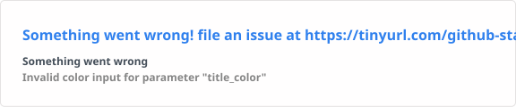

<div align="center">



<a href="https://www.linkedin.com/in/siddharthtaurani/"></a>
<a href="https://siddharth-taurani.vercel.app/"></a>
<a href="https://medium.com/@siddharth_1254"></a>
<a href="mailto:siddharth.taurani@gmail.com"></a>


<br/><br/>



</div>


## 🛰️ &nbsp;About me

```python
class Siddharth:
    school   = "aivancity Paris — Programme Grande École, year 4"
    track    = "AI & Data Science"
    based_in = "Paris, France 🇫🇷"

    builds   = ["RAG pipelines", "AI agents (MCP, LangChain)", "compliance workflows"]
    studying = "LLM uncertainty — ClaimCheck research project"
    shipped  = "6 AI Clinic projects for real client companies + an AI internship"

    looking_for = {
        "contract": "alternance · AI Engineering / Data Science · 12–24 months",
        "rhythm":   "3 weeks company / 1 week school",
        "where":    "anywhere in France — available now",
    }

    def philosophy(self):
        return "Build things properly. Understand them clearly. Improve step by step."
```

> ⚡ **Fun fact** — I like breaking complex topics into smaller pieces until they finally *click*. That moment is my favourite part of learning.


## 🧬 &nbsp;What I build

<div align="center">

</div>

<table>
<tr>
<td width="50%" valign="top">

### 🧾 CERC-Assistant
RAG-based AI assistant shipped to a client through aivancity's **AI Clinic**.
React + TypeScript front, Python back, retrieval with source grounding, and an observability layer so every answer can be traced.
`RAG` `LangChain` `FAISS` `React` `TypeScript`

</td>
<td width="50%" valign="top">

### 🔬 ClaimCheck <sub>· research</sub>
Year-long research project on **claim-level uncertainty fingerprints** for long-form LLM output — and how surfacing them changes human decisions.
`LLM reliability` `uncertainty` `HCI`

</td>
</tr>
<tr>
<td valign="top">

### 🛠️ Pangea Summit
AI clinic project → internship → part-time **Project Assistant – AI**.
Over a year of building AI workflows with the same team.
`agents` `automation` `Python`

</td>
<td valign="top">

### 🏗️ AI Clinic × 6
Real-world projects for partner companies — data extraction, AI assistants, compliance workflows — scoped, built and handed over.
`client delivery` `data` `AI`

</td>
</tr>
</table>

## 📌 &nbsp;Featured repos

<div align="center">

<a href="https://github.com/Siddharth1254/mcp-debugging-agent"></a>
<a href="https://github.com/Siddharth1254/ai-cold-email-generator"></a>
<a href="https://github.com/Siddharth1254/alterna-genie-mvp"></a>
<a href="https://github.com/Siddharth1254/portfolio-website"></a>

</div>


## 💻 &nbsp;Toolbox

<div align="center">

**AI / ML**


<br/>


**Backend & apps**


<br/>


**Data & infra**


<br/>


</div>


## 📊 &nbsp;GitHub in numbers

<div align="center">





<picture>
  <source media="(prefers-color-scheme: dark)" srcset="https://raw.githubusercontent.com/Siddharth1254/Siddharth1254/output/github-snake-dark.svg"/>
  <source media="(prefers-color-scheme: light)" srcset="https://raw.githubusercontent.com/Siddharth1254/Siddharth1254/output/github-snake.svg"/>
  
</picture>

</div>

## 🗺️ &nbsp;Journey

<details>
<summary><b>click to expand the timeline</b></summary>
<br/>

| When | What |
|---|---|
| **2026 →** | 🔬 ClaimCheck research project · 🎯 looking for an AI / Data alternance |
| **Jan – Apr 2026** | 🧾 CERC — RAG assistant shipped (AI Clinic) |
| **Oct 2025 – Apr 2026** | 🛠️ Pangea Summit — Project Assistant, Artificial Intelligence (part-time) |
| **Sep – Dec 2025** | 📑 AF Advisory (AI Clinic) |
| **May – Aug 2025** | 💼 Pangea Summit — AI internship |
| **Jan – Apr 2025** | 🌍 Pangea Summit (AI Clinic) |
| **Sep – Dec 2024** | 📊 CMI Stratégies — data extraction (AI Clinic) |
| **2023 – 2024** | 🌱 Substrate AI · X&Y Corp — first AI Clinic projects |

</details>

## 🤝 &nbsp;Let's build something

I'm open to collaborating on AI and data projects — especially anything involving **retrieval, agents, or making LLMs more trustworthy**.
If you're hiring an **alternant in AI Engineering or Data Science**, my inbox is open → **siddharth.taurani@gmail.com**


