<div align="center">


<h3><code>sidd@github ~ $ ./links.sh</code></h3>

<a href="https://www.linkedin.com/in/siddharthtaurani/"></a>
<a href="https://siddharth-taurani.vercel.app/"></a>
<a href="https://medium.com/@siddharth_1254"></a>
<a href="mailto:siddharth.taurani@gmail.com"></a>


<br/><br/>


<!-- whoami row: ASCII portrait (left, one-off, scripts/make_ascii_svg.py) + streak card
     (right, rebuilt daily on the output branch). Both SVGs are 840x880 so they line up. -->

<h3><code>sidd@github ~ $ whoami</code></h3>

<table>
<tr>
<td valign="top" width="50%"></td>
<td valign="top" width="50%"></td>
</tr>
</table>

</div>


<h3><code>sidd@github ~ $ cat about.py</code></h3>

## 🛰️ &nbsp;About me

```python
class Siddharth:
    school   = "aivancity Paris — Programme Grande École, year 4"
    track    = "AI & Data Science"
    based_in = "Paris, France 🇫🇷"

    interests  = ["machine learning", "LLM systems", "AI agents", "data engineering", "automation"]
    experience = "real client projects through aivancity's AI Clinic + an AI internship"
    currently  = "research on LLM reliability + looking for an alternance"

    looking_for = {
        "contract": "alternance · AI Engineering / Data Science · 12–24 months",
        "rhythm":   "3 weeks company / 1 week school",
        "where":    "anywhere in France — available now",
    }

    def philosophy(self):
        return "Build things properly. Understand them clearly. Improve step by step."
```

> ⚡ **Fun fact** — I like breaking complex topics into smaller pieces until they finally *click*. That moment is my favourite part of learning.


<h3><code>sidd@github ~ $ ./build.sh --how</code></h3>

## 🧬 &nbsp;What I build

<div align="center">

</div>

<table>
<tr>
<td width="50%" valign="top">

### 🧠 RAG & knowledge assistants
Assistants that answer from *your* documents — retrieval, grounding and citations, so every answer can be checked and traced back to its source.
`LangChain` `FAISS` `sentence-transformers`

</td>
<td width="50%" valign="top">

### 🤖 AI agents & automation
Tool-using agents and workflow automation that take repetitive work off people's plates — wired to real systems through MCP and APIs.
`agents` `MCP` `workflow automation`

</td>
</tr>
<tr>
<td valign="top">

### 📊 Data science & ML
From raw, messy data to decisions: analysis, feature work, models and dashboards that people actually read.
`pandas` `scikit-learn` `Power BI`

</td>
<td valign="top">

### 🔬 ClaimCheck <sub>· research</sub>
<sub>🟢 In progress · 2026–27 research year</sub>

Year-long research project on **claim-level uncertainty fingerprints** for long-form LLM output — and how surfacing them changes human decisions.
`LLM reliability` `uncertainty` `HCI`

</td>
</tr>
</table>


<h3><code>sidd@github ~ $ ls ~/toolbox</code></h3>

## 💻 &nbsp;Toolbox

<div align="center">

**AI / ML**


<br/>


**Backend & apps**


<br/>


**Data & infra**


<br/>


</div>


<h3><code>sidd@github ~ $ ./stats.sh</code></h3>

## 📊 &nbsp;GitHub in numbers

<!-- Everything in this section is rebuilt daily by .github/workflows/profile-art.yml
     and published to the `output` branch. Never edit those files by hand. -->

<div align="center">




<picture>
  <source media="(prefers-color-scheme: dark)" srcset="https://raw.githubusercontent.com/Siddharth1254/Siddharth1254/output/github-snake-dark.svg"/>
  <source media="(prefers-color-scheme: light)" srcset="https://raw.githubusercontent.com/Siddharth1254/Siddharth1254/output/github-snake.svg"/>
  
</picture>



</div>

<h3><code>sidd@github ~ $ git log --reverse</code></h3>

## 🗺️ &nbsp;Journey

<details>
<summary><b>click to expand the timeline</b></summary>
<br/>

| When | What |
|---|---|
| **2026 →** | 🔬 ClaimCheck research project · 🎯 looking for an AI / Data alternance |
| **Jan – Apr 2026** | 🧾 CERC — RAG assistant shipped (AI Clinic) |
| **Oct 2025 – Apr 2026** | 🛠️ Pangea Summit — Project Assistant, Artificial Intelligence (part-time) |
| **Sep – Dec 2025** | 📑 AF Advisory (AI Clinic) |
| **May – Aug 2025** | 💼 Pangea Summit — AI internship |
| **Jan – Apr 2025** | 🌍 Pangea Summit (AI Clinic) |
| **Sep – Dec 2024** | 📊 CMI Stratégies — data extraction (AI Clinic) |
| **2023 – 2024** | 🌱 Substrate AI · X&Y Corp — first AI Clinic projects |

</details>

<h3><code>sidd@github ~ $ ./contact.sh</code></h3>

## 🤝 &nbsp;Let's build something

I'm open to collaborating on AI and data projects — from data pipelines and ML models to LLM assistants and agents, built end to end and measured properly.
If you're hiring an **alternant in AI Engineering or Data Science**, my inbox is open → **siddharth.taurani@gmail.com**


